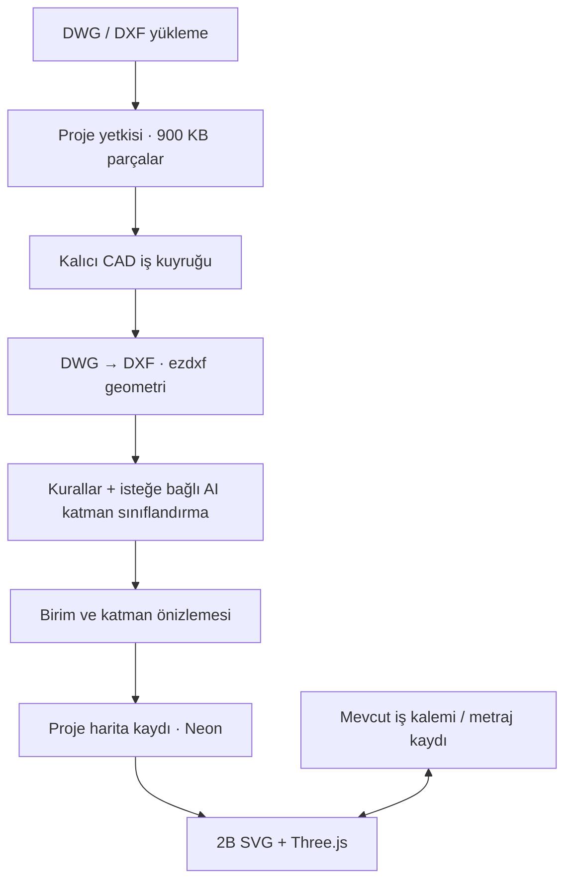

# CephePro V251 — İnteraktif saha haritası ve canlı 3B

## Hazır olanlar ve bağlantı gerektirenler

| Bileşen | Bu paketteki durum |
|---|---|
| Proje Bilgileri solunda kompakt Harita düğmesi; üst çubuktan hızlı erişim | Uygulandı |
| Tam ekran 2B plan; fare/pinch zoom, pan, klavyeden seçim; arama ve durum filtresi | Uygulandı |
| Masaüstü yan kartı / mobil alt kart; blok adı, tipi, yüzde, iş kalemleri | Uygulandı |
| Mevcut proje cephesi veya bir bloğun bütün cepheleriyle eşleştirme | Uygulandı |
| Three.js döndürme/zoom; tel kafes, sarı dolgu, tamamlanmış katı malzeme | Uygulandı |
| Metraj ↔ yüzde ↔ model rengi | Mevcut proje kaydından çift yönlü; diğer cihazlar yaklaşık 4 saniyede yenilenir |
| DXF / GeoJSON | Tarayıcı işçisinde çalışır; katman kontrolü sonrası kaydedilir |
| DWG | Ayrı CAD servisi + uygun DWG dönüştürücüsü kurulmalı. Bu paket bunları canlı altyapıda kurmuş değildir. |
| AI katman sınıflandırma | Yerel/özel Ollama servisi bağlanınca çalışır. Bağlı değilse açıkça “Kurallı sadeleştirme” gösterilir. |
| Gerçek 3B model | Gömülü kaynaklı GLB 2.0 yüklenebilir; en fazla 2 MB/model ve 100 model/proje. Model parçaları iş kalemlerine elle bağlanır. |
| 3B model olmayan blok | Açıkça işaretlenmiş şematik model. 2B plandan gerçek mimari model üretildiği iddia edilmez. |

## 1. Hızlı deneme

CephePro kökünü HTTP ile sunun; dosyayı `file://` ile açmayın:

```bash
cd cephepro
python3 -m http.server 8080
```

`http://localhost:8080/map-demo.html` adresini açın. Villa 412 kartında **3B Gör** seçin; Betonarme yüzdesini 0, 47, 100 yapın. Örnek gerçek proje verisine dokunmaz ve değişiklikleri kalıcı kaydetmez. Ekranı daraltarak mobil alt kartı deneyin.

`examples/site-map-demo.geojson` dosyası, çizim yükleme ve katman inceleme için örnektir. Gerçek proje planı değildir. `examples/site-map-schema.json` gerçek iş kalemine bağlanan örnek veri sözleşmesidir; örnekteki kaynak isimlerini kendi projenize göre değiştirin.

## 2. Mevcut uygulamadaki kullanım

1. Projeye giriş yapın; **Harita → Çizim Yükle** seçin.
2. DXF veya GeoJSON yükleyin; katman önizlemesinde ölçü, not, tarama ve eksenlerin ayıklandığını kontrol edin. Belirsiz katmanların kategorisini düzeltin. Birimi seçip **Planı Kaydet** deyin.
3. Haritadan bina seçin. **Blok bilgileri** altında ad/tip/yükseklik girin. **Proje cephesine bağla** ile ör. `C ISLAND / 92 & 405` seçin. Bir bloğun bütün cephelerini bağlamak için `C ISLAND / Tümü` seçeneğini kullanın.
4. Bağlanan iş kalemlerinin mevcut metrajları otomatik gelir. Yüzde değişikliği, toplam metraja göre yapılan metrajı günceller. Geçmiş günlük kayıtlar silinmez; kümülatifte çift sayılmaları engellenir. Sıfır toplam metrajlı kalem güncellenemez.
5. **3B Gör** ile modeli açın. Şematik parçaları Betonarme/Duvar/Çatı/Cephe/Havuz/Peyzaj türlerine atayabilirsiniz.
6. Gerçek GLB yüklediğinizde 3B görünümde **3B parça eşleştirmesi** bölümünden model düğümlerini iş kalemlerine bağlayın. Eşleşmeyen parça soluk gösterilir. Bir parçaya birden çok kalem bağlıysa en düşük ilerleme kullanılır; kalemlerin tümü bitmeden parça bitmiş gösterilmez.

Üyeler bağlı iş kalemlerinin ilerlemesini mevcut proje yetkileriyle güncelleyebilir. Harita/GLB yükleme, eşleştirme ve bağımsız harita kalemleri yöneticiye aittir. Başka proje koduna ait veri veya model okunamaz. Proje kilitlendiğinde harita kapanır; işlem ve WebGL kaynakları temizlenir.

## 3. Teknik mimari



- **Mevcut kod tabanı:** bağımsız JavaScript + Vercel API işlevleri. Next.js'e zorunlu taşıma yapılmadı. Modüller ES module olduğu için React/Next.js istemci bileşeninde de kullanılabilir.
- **2B:** yerel CAD XY koordinatları, SVG ve pointer olayları. WGS84 enlem/boylam verileri metre gibi yorumlanmamalı; bilinen CRS ile önce yerel projeksiyona çevrilmeli.
- **3B:** yerelde paketlenmiş Three.js 0.180.0, OrbitControls, GLTFLoader. Yalnız kullanıcı 3B açınca yüklenir. CDN bağımlılığı yok. Örnek şematik model BIM modeli değildir.
- **Tarayıcı DXF:** Web Worker içinde dxf-parser; çizgi/polyline, bulge, yay/daire, döndürülmüş/ölçekli INSERT desteklenir. Desteklenmeyen varlık sayısı kullanıcıya gösterilir. Karmaşık spline veya nested CAD için Python servisi tercih edilir.
- **CAD servisi:** FastAPI + SQLite kalıcı kuyruk + tek ağır iş çalışanı; dönüştürme ayrı süreçte, 150 saniye sınırında. 40 MB dosya, 2000 şekil ve 100000 nokta sınırı. Büyük çizimler bölünmeli. Docker örneği CPU/RAM/PID sınırları içerir.
- **AI:** yalnız katman adı/tür/adet gibi özetleri sınıflandırır; geometri/koordinat üretmez. Yüksek güvenli sınıflar uygulanır, belirsizler kontrol ekranına gider. Ollama dışarıya açık bir servise işaret etmediği sürece CAD özeti özel altyapıda kalır. Yerel model API kullanım ücreti gerektirmez; sunucu ve hesaplama maliyeti vardır.
- **Canlı güncelleme:** aynı ekranda anlık yerel 3B önizleme, kayıttan sonra yetkili sunucu sonucu; açık haritada 4 saniyelik sorgu. WebSocket değil. Ağ hataları ve eşzamanlı değişiklikler görünür; başarı gibi gösterilmez.
- **Veri tutarlılığı:** map revision + proje revision denetimi. Bağlı kalemlerde tek SQL karşılaştırmalı güncelleme; diğer cihazın yeni metrajı sessizce ezilmez. Harita kaydı mevcut rapor verisini taşımaz/kopyalamaz.

Çok büyük projelerde önerilen sonraki ölçekleme: kaynak DWG ve büyük GLB için imzalı object-storage yüklemeleri; Redis/SQS tabanlı iş kuyruğu; ayrı CAD worker havuzu; GLB optimizasyonu ve LOD; PostgreSQL outbox/SSE. Bu servis örneğinde çoklu Uvicorn worker açmayın; SQLite iş kuyruğu tek çalışan içindir.

## 4. DWG ve AI servisini bağlama

```bash
cd cad-service
python3 -m venv .venv
. .venv/bin/activate
pip install -r requirements.txt
export CAD_SERVICE_KEY='uzun-rastgele-bir-sir'
export CAD_DATA_DIR='/kalici-disk/cephepro-cad'
# İsteğe bağlı, kendi Ollama kurulumunuz ve önceden indirilmiş modeliniz:
export OLLAMA_URL='http://127.0.0.1:11434'
export OLLAMA_MODEL='kurulu-model-adi'
uvicorn server:app --host 127.0.0.1 --port 8000 --workers 1
```

Docker alternatifi: `CAD_SERVICE_KEY` tanımlayıp `docker compose up --build -d` çalıştırın. Docker görüntüsünde ODA yer almaz; DXF hemen çalışır. DWG için platformunuza uygun, lisansı sağlanmış ODA File Converter/Drawings dönüştürücüsünü ayrıca kurun; `ODA_EXECUTABLE` ile yürütülebilir yolunu tanımlayın. Gerekirse ODA'nın Linux bağımlılıkları ve Xvfb bulunan kendi türetilmiş görüntünüzü oluşturun. ODA indirme paketinin ticari kullanımını ücretsiz varsaymayın; üretici koşullarını kontrol edin.

Worker'ı özel ağ veya HTTPS ters vekil arkasına koyun. Vercel proje ortamına yalnız sunucu değişkenleri olarak şunları ekleyin:

```text
CAD_SERVICE_URL=https://cad.sizin-alaniniz.example
CAD_SERVICE_KEY=worker-ile-ayni-sir
```

Bunları `NEXT_PUBLIC_*` veya istemci JavaScript'ine koymayın. Tarayıcı Vercel'in korumalı `/api/site-map` uç noktasına konuşur; worker sırrını alamaz. Her iş proje kimliğine bağlıdır. Önizleme kaydedilmeden proje haritası değişmez. Servis bağlı değilse DWG yüklemesi anlaşılır bir hata verir, DXF/GeoJSON akışı kullanılmaya devam eder.

## 5. Veri sözleşmesi ve API

`schemaVersion:1` haritası `features[]` içerir. Her bina kapalı Polygon, blok adı/tipi, metre cinsinden yükseklik, `binding`, `components[]` ve isteğe bağlı `modelId` taşır. İş kalemi `source:{block,facade,item}` varsa ilerleme bu kaynakta saklanır; yoksa bağımsız harita kalemidir. `meshNodes[]` gerçek modelin hiyerarşik düğüm yollarıdır. `part` yalnız şematik model parça türüdür.

| Uç nokta | İşlev |
|---|---|
| `GET /api/site-map` | Harita, revizyonlar, yetkiye uygun metraj kataloğu |
| `PUT /api/site-map` | Yönetici harita/eşleştirme kaydı, revision zorunlu |
| `PATCH /api/site-map` | featureId, componentId, progress, revision, projectRevision |
| `POST /api/site-map` action=model | Gömülü kaynaklı GLB kaydı |
| `GET /api/site-map?model=id` | Yalnız aynı projeye ait GLB |
| `POST /api/site-map` action=upload-start/chunk/finish | Yetkili, parçalı DWG yükleme ve iş başlatma |
| `GET /api/site-map?job=id` | Aynı projeye ait dönüşüm durumu/sonucu |

Mevcut uygulamada iş kalemleri isimle tanımlandığı için kaynak sözleşmesi de bu üçlü anahtarı kullanır. Bağlı cephe veya kalem yeniden adlandırılırsa “Bağlı iş kalemi bulunamadı” uyarısından eşleştirme yenilenmelidir. Kalıcı UUID tabanlı yapı modeline geçiş, sonraki veritabanı dönüşümünde yapılabilir; ad değişikliğinde başka kaleme kendiliğinden bağlanmaz.

## 6. Modüler kodlar

| Dosya | Sorumluluk |
|---|---|
| `assets/site-map/bootstrap.js` | Kompakt düğmeler, gecikmeli modül yükleme |
| `assets/site-map/app.js` | Tam ekran 2B, kart, içe aktarma incelemesi, kayıt ve canlı sorgu |
| `assets/site-map/model.js` | Ortak veri sözleşmesi, doğrulama, metraj/ilerleme hesapları |
| `assets/site-map/viewer.js` | WebGL, model yükleme/eşleştirme, malzeme durumu, temizleme |
| `assets/site-map/importer.js`, `import-worker.js` | Tarayıcı DXF/GeoJSON işleme |
| `assets/site-map/i18n.js`, `site-map.css` | TR/EN/DE/FR/RU/AR ve responsive görünüm |
| `api/site-map.js`, `lib/site-map.js` | Proje erişimi, yetkiler, CAS kayıt, model ve CAD köprüsü |
| `cad-service/server.py`, `convert.py` | DWG/DXF kuyruğu, geometri, isteğe bağlı AI |
| `examples/NextMapButton.tsx` | İsteğe bağlı Next.js istemci sarmalayıcı örneği |

## 7. Derleme ve test

Paket içindeki vendor dosyaları hazırdır. Yeniden üretmek için Node 22+ ile:

```bash
npm ci
npm run build:site-map
node --test tests/site-map.test.mjs tests/site-map-ui.test.mjs tests/project-ui.test.mjs
python3 -m unittest discover -s cad-service -p test_cad.py
```

Testler sentetik proje/DXF verisi kullanır; gerçek şantiye verilerine dokunmaz. Gerçek DWG dönüştürücü ve kullanıcının gerçek mimari GLB dosyası olmadan onların çıktısı doğrulanmış sayılmaz.

Kaynaklar: https://threejs.org/docs/pages/GLTFLoader.html · https://threejs.org/docs/pages/OrbitControls · https://ezdxf.readthedocs.io/en/stable/addons/odafc.html · https://www.opendesign.com/guestfiles/oda_file_converter · https://www.opendesign.com/faq/question/what-are-oda-viewer-and-oda-file-converter
